  
  
  

## 👋 About Me

I'm a **Software Engineer at [AmaliTech](https://www.amalitech.com)**. I build **production web applications**,
mostly on the frontend: typed React apps, the API contracts behind them, and the tests that keep them
shippable. Outside the frontend I'm going deeper into **Python, data engineering, machine learning and
applied AI**.

> This account holds my AmaliTech work only.

## 🧭 What I Work On

<table>
  <tr><td width="230">🏢 <b>Web applications</b></td><td>Production apps built in cross-functional teams with backend, QA and design</td></tr>
  <tr><td>🧱 <b>Frontend architecture</b></td><td>Routing, server state, forms and validation in a TypeScript monorepo</td></tr>
  <tr><td>🤝 <b>API contracts</b></td><td>Agreed with backend teams before the UI is built, with mocked endpoints in between</td></tr>
  <tr><td>✅ <b>Quality</b></td><td>Unit, component and end-to-end tests, accessibility and internationalisation</td></tr>
</table>

## 🛠️ Tech Stack

<table>
  <tr>
    <td width="170"><b>Languages and frameworks</b></td>
    <td></td>
  </tr>
  <tr>
    <td><b>Testing and tooling</b></td>
    <td></td>
  </tr>
  <tr>
    <td><b>Also worked with</b></td>
    <td></td>
  </tr>
  <tr>
    <td><b>Libraries</b></td>
    <td>
      
      
      
      
      
      
      
      
      
      
      
    </td>
  </tr>
</table>

## 🔭 Currently Exploring

  
  
  
  

Building on Python to work with data pipelines, machine learning models and AI features that fit into
real products.

## ⚙️ How I Work

- Small, reviewable pull requests tied to a ticket, with Conventional Commit messages
- Tests written alongside the change, not after it
- Accessibility checked on every UI change
- Contract first: the API shape is agreed and documented before either side builds against it

## 🎯 Current Goals

- 🚀 Deliver on client projects and build products that serve real users
- 🌱 Deepen frontend architecture and performance work on large React codebases
- 🧠 Grow from Python into data engineering, machine learning and applied AI
- ⚙️ Take on more backend and API design alongside the frontend

## 💼 Work Contact

📩 **[illona.addae@amalitech.com](mailto:illona.addae@amalitech.com)**
Open to collaboration, code reviews and project discussions.

 

> _"Consistency compounds. Every line of code you write today builds the developer you become tomorrow."_

